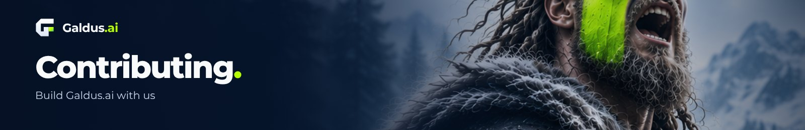

# Contributing

Thanks for helping build Galdus.ai. This guide covers the local setup, the conventions the codebase follows and what a good pull request looks like.

## Local development

| Part | Command | Notes |
|:--|:--|:--|
| Everything | `docker compose up --build -d` | Web on :5173, API on :8000, migrations run automatically |
| API only | `cd apps/api && pip install -e ".[dev]" && uvicorn app.main:app --reload` | Needs PostgreSQL 16 with pgvector and a `DATABASE_URL` |
| API tests | `cd apps/api && pytest` | Uses the database in `DATABASE_URL`; runs in CI on every push |
| Web only | `cd apps/web && npm install && npm run dev` | Set `VITE_API_BASE_URL` when the API is not behind `/api` |
| Migrations | `cd apps/api && alembic revision -m "short description"` | One migration per schema change, never edit a merged one |

## Conventions

- **Architecture.** Keep the modular monolith: one module per domain in `apps/api/app/`, one page per area in `apps/web/src/`. Record significant decisions as an ADR in `docs/architecture/`.
- **Tenancy.** Every endpoint that touches workspace data depends on `current_membership` and filters by organization. Add a test that a second workspace gets a 403.
- **Secrets.** Provider keys go through `crypto.encrypt`. Never log prompts, tokens or keys, and never return provider errors verbatim.
- **Model output.** Treat model output, retrieved documents and tool results as untrusted input and pass them through the guardrails.
- **Design.** Use the brand tokens in `apps/web/src/style.css` (Blue Night, Lime, Energy Yellow, Cloud White, Montserrat), lucide icons and gradients rather than flat fills. Respect `prefers-reduced-motion` for every animation.
- **Dependencies.** Check the license of each new dependency and note it in the pull request.

## Pull requests

1. Branch from `main` with a descriptive name such as `feat/knowledge-sync` or `fix/chat-retry`.
2. Describe the problem, the change, how you tested it and any security or migration impact.
3. Add screenshots for visible UI changes, on desktop and on a phone.
4. Keep CI green: API tests, web build and Docker image.

## Reporting security issues

Do not open a public issue. Follow [SECURITY.md](SECURITY.md).

## License

Contributions are made available under AGPL-3.0-only. By submitting a contribution you confirm you have the right to submit it under these terms.
