<p align="center">
  <a href="https://coobox-89.github.io/galdus.ai/">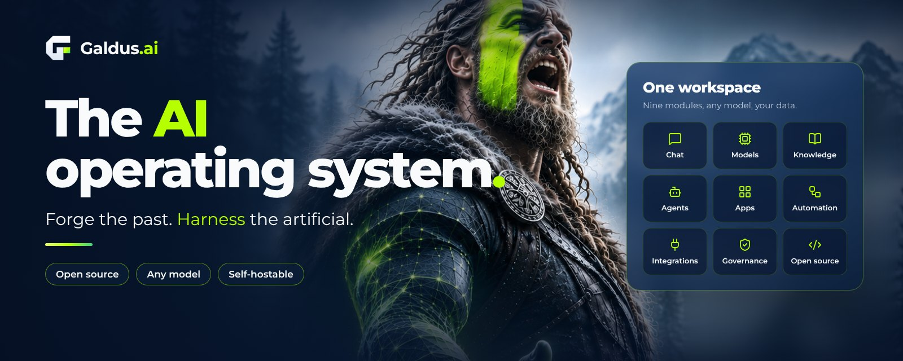</a>
</p>

<p align="center">
  
</p>

<h3 align="center">The open source AI operating system.<br>Bring any model. Keep your data.</h3>

<p align="center">
  <a href="https://coobox-89.github.io/galdus.ai/"></a>
  <a href="LICENSE"></a>
  <a href="CHANGELOG.md"></a>
  <a href="https://github.com/coobox-89/galdus.ai/actions"></a>
</p>

<p align="center">
  <a href="#what-is-inside">Modules</a> ·
  <a href="#see-it">Screens</a> ·
  <a href="#quick-start">Quick start</a> ·
  <a href="docs/DEPLOYMENT.md">Deploy</a> ·
  <a href="docs/README.md">Docs</a> ·
  <a href="CONTRIBUTING.md">Contribute</a>
</p>

<br>

Galdus.ai brings models, knowledge, agents, automation and governance together in one workspace you can host yourself. It is model agnostic by design: every workspace connects its own providers with its own keys, from OpenAI and Anthropic to open-weight models such as Qwen, DeepSeek, Llama and Mistral running on your own hardware.

> [!NOTE]
> **Early access.** Galdus.ai 0.6 runs as a free public preview on GitHub Pages, Render and Supabase. The free API sleeps when idle, so the first request after a pause can take up to a minute.

## What is inside

<p align="center">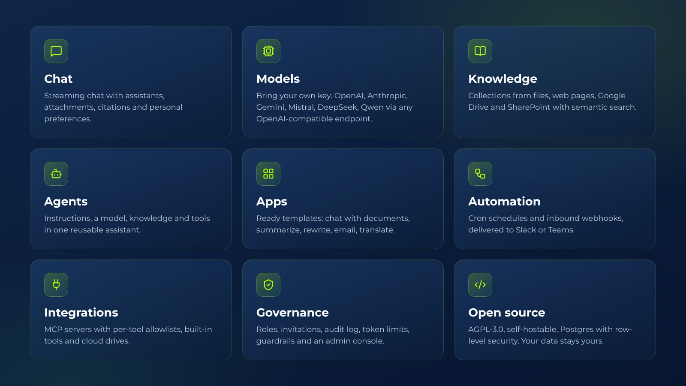</p>

| Module | What you can do |
|:--|:--|
| **Chat** | Stream answers from any connected model, attach files and images, pick an assistant persona, ground replies in a knowledge collection with citations, pin and search past chats. |
| **Models** | Connect OpenAI, Anthropic, Gemini, Mistral, DeepSeek, OpenRouter, Groq, Together, Fireworks, xAI, Ollama or any OpenAI-compatible endpoint (vLLM, LM Studio, TGI). Type any model name. Keys are encrypted at rest. |
| **Knowledge** | Build collections from uploads, public web pages, Google Drive and SharePoint or OneDrive. Semantic search with pgvector when an embedding model is set, keyword search otherwise. |
| **Agents** | Combine instructions, a model, knowledge and tools into a reusable assistant. Every run is stored with its steps and tool calls. |
| **Apps** | Eight ready tools: chat with documents, summarize, rewrite tone, draft an email, IT ticket triage, contract review, meeting notes to actions, translate. |
| **Automation** | Run agents on a cron schedule or from an inbound webhook (n8n, Make, Zapier, ITSM tools) and deliver results to Slack or Teams. |
| **Integrations** | Connect MCP servers over Streamable HTTP with a per-tool allowlist, use built-in tools (calculator, date and time, web fetch, knowledge search) and link cloud drives. |
| **Governance** | Owner, admin and member roles, invitation links, audit log, monthly token limits, prompt-injection guardrails and a platform admin console. |
| **Open source** | AGPL-3.0, self-hostable with Docker Compose, PostgreSQL with row-level security. Sign in with email, Google or GitHub. |

## See it

<table>
  <tr>
    <td width="50%">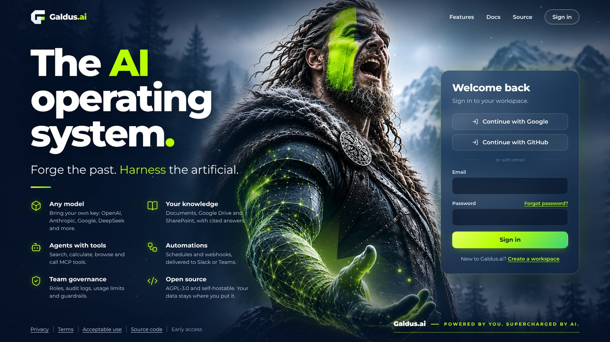<p align="center"><b>Sign in</b> with email, Google or GitHub</p></td>
    <td width="50%">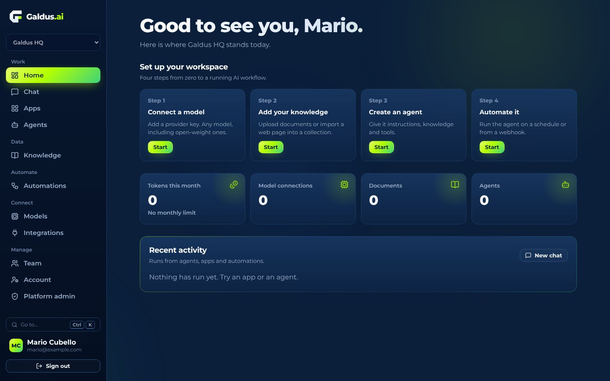<p align="center"><b>Home</b> with guided setup and live usage</p></td>
  </tr>
  <tr>
    <td width="50%">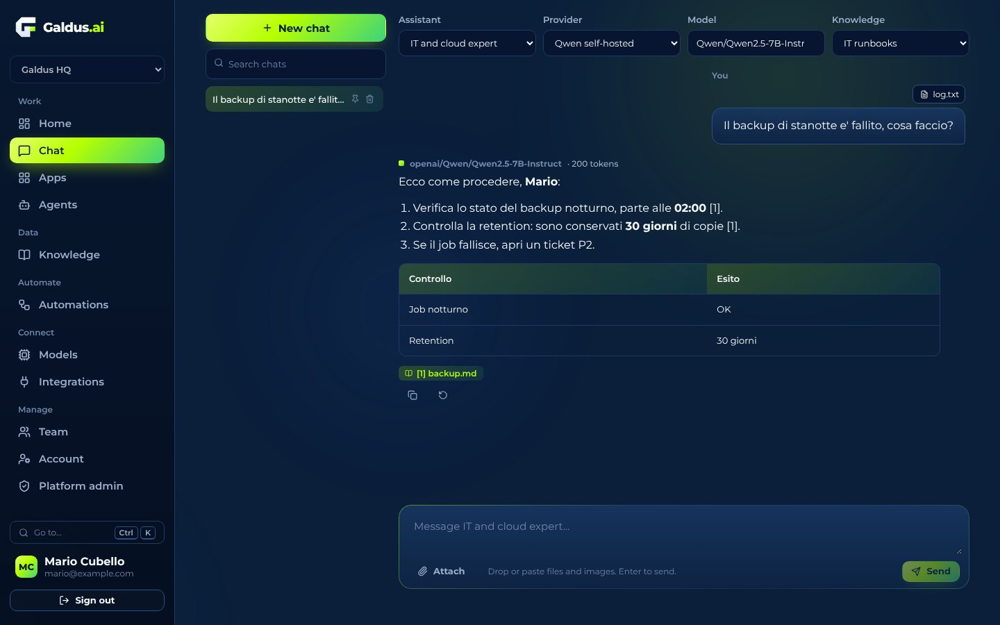<p align="center"><b>Chat</b> grounded in your documents</p></td>
    <td width="50%">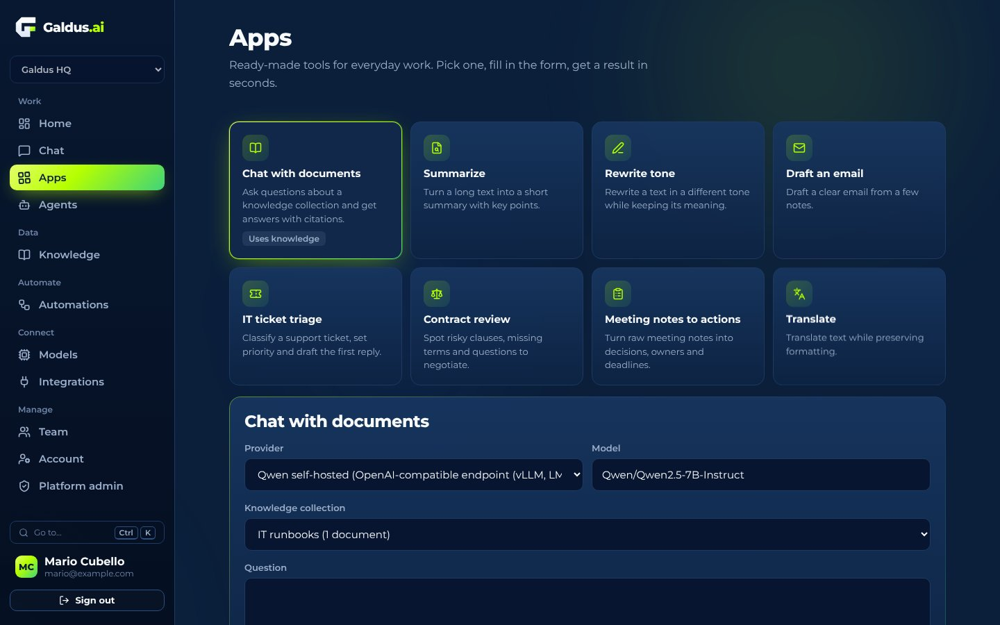<p align="center"><b>Apps</b> for everyday work</p></td>
  </tr>
  <tr>
    <td width="50%">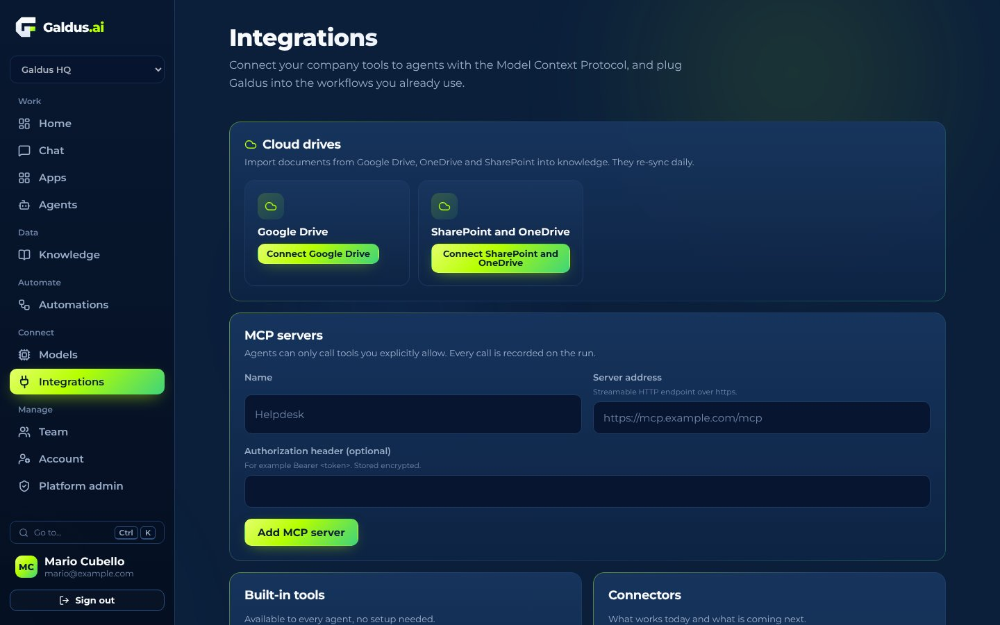<p align="center"><b>Integrations</b> with MCP and cloud drives</p></td>
    <td width="50%">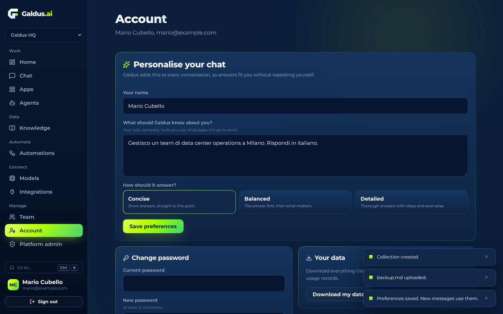<p align="center"><b>Account</b> and personal chat preferences</p></td>
  </tr>
</table>

## Quick start

You need Docker with Compose.

```bash
git clone https://github.com/coobox-89/galdus.ai.git && cd galdus.ai
cp .env.example .env          # set POSTGRES_PASSWORD, JWT_SECRET and ENCRYPTION_KEY
docker compose up --build -d  # database migrations run automatically
```

Open the console at http://localhost:5173 and the API reference at http://localhost:8000/docs. Create an account: registration also creates your workspace. Then open **Models**, connect a provider with your key and start chatting.

Secrets live only in the backend `.env` or in your hosting provider's secret store. Never put them in browser code, `VITE_*` variables or commits.

## Architecture

<p align="center">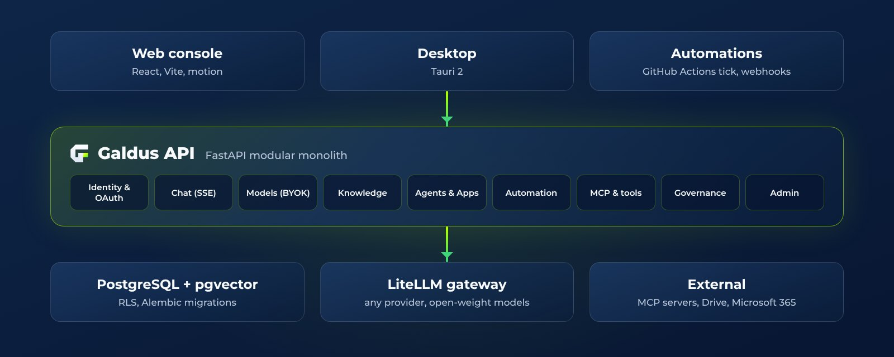</p>

A modular monolith keeps development and hosting simple while the product grows ([ADR 0001](docs/architecture/0001-modular-monolith.md)).

| Layer | Stack |
|:--|:--|
| Web and desktop | React 18, Vite, motion, lucide icons, Montserrat; Tauri 2 desktop shell in `apps/web/src-tauri` |
| API | FastAPI, SQLAlchemy async, Alembic, server-sent events for streaming |
| Models | LiteLLM with per-workspace encrypted provider keys (Fernet) |
| Data | PostgreSQL 16 with pgvector and row-level security |
| Scheduling | croniter, woken every 15 minutes by a GitHub Actions workflow |

## Deploy

The public preview runs at zero cost on GitHub Pages (web), Render free (API) and Supabase free (database). The full runbook, including Google, GitHub and Microsoft sign-in, SMTP email and scaling up, is in [docs/DEPLOYMENT.md](docs/DEPLOYMENT.md).

## Desktop

From `apps/web`, with Rust and the platform prerequisites installed, run `npm install` and `npm run tauri build`. Set `VITE_API_BASE_URL` to your API's public URL (for example `https://api.example.com/api`) at build time. CI publishes desktop builds as workflow artifacts.

## Brand

| | Color | Hex |
|:--:|:--|:--|
|  | Blue Night | `#0B1F3B` |
|  | Lime | `#B6FF00` |
|  | Energy Yellow | `#FFC107` |
|  | Cloud White | `#F8FAFC` |

Typeface: Montserrat. Logo files: [`logo.svg`](docs/assets/logo.svg) and [`logo-animated.svg`](docs/assets/logo-animated.svg).

## Documentation

| Guide | |
|:--|:--|
| [Deployment](docs/DEPLOYMENT.md) | Hosting, environment variables, sign-in providers, smoke tests |
| [Security](docs/security/overview.md) | Implemented controls, open gaps, how to report a vulnerability |
| [Roadmap](docs/product/roadmap.md) | What ships today and what comes next |
| [Architecture](docs/architecture/0001-modular-monolith.md) | Decision records |
| [Changelog](CHANGELOG.md) | Release history |
| [License compliance](docs/license-compliance.md) | AGPL-3.0 obligations before each release |
| [Project handoff](docs/CLAUDE_HANDOFF.md) | Full context for an AI coding agent continuing the work |

## Contributing

Issues and pull requests are welcome. Read [CONTRIBUTING.md](CONTRIBUTING.md) first.

## License

GNU Affero General Public License v3.0 only (`AGPL-3.0-only`). See [LICENSE](LICENSE) and the [license compliance notes](docs/license-compliance.md). Third-party components keep their own licenses.

<p align="center"><br><br><sub><b>Galdus.ai</b> · Powered by you. Supercharged by AI.</sub></p>
