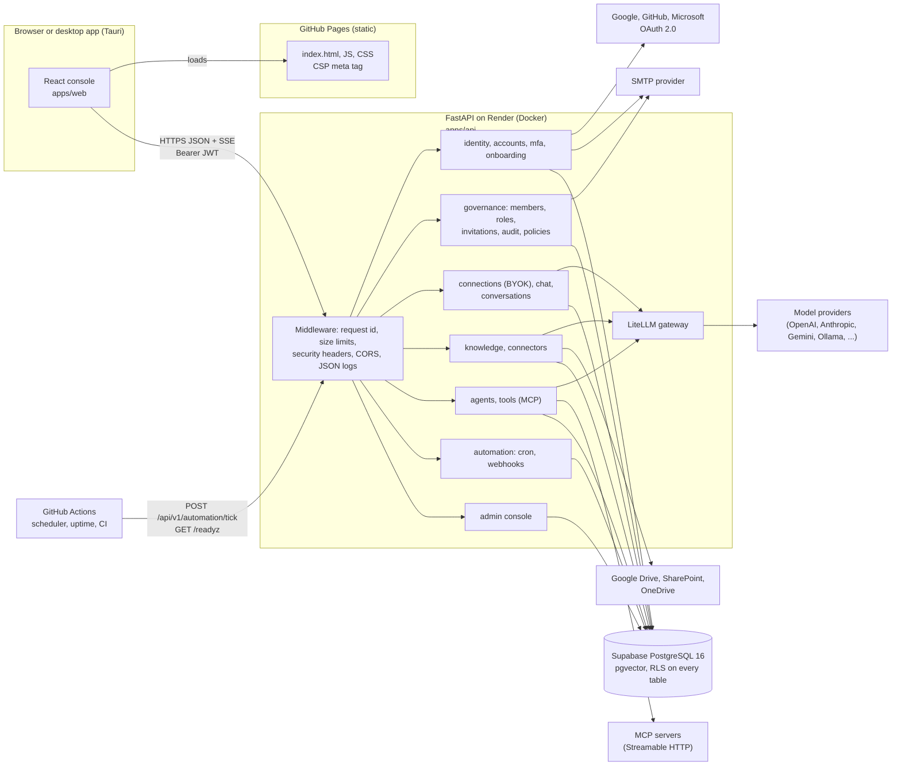
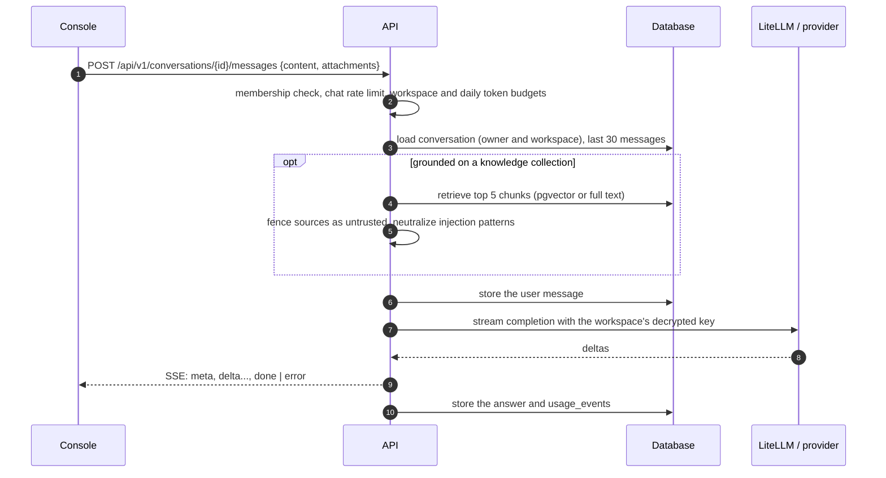
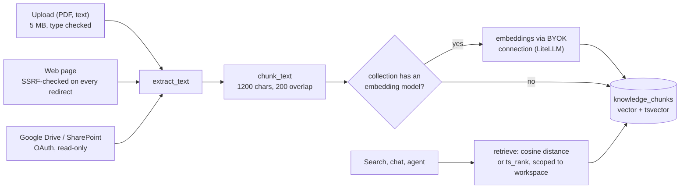

<p align="center"></p>

# Architecture

Galdus.ai is a modular monolith ([ADR 0001](architecture/0001-modular-monolith.md)): one FastAPI service with one module per domain, one PostgreSQL database and a static React console. This page shows the components and the four main flows: authentication, chat, knowledge and automations.

## Components



| Component | Where | Notes |
|:--|:--|:--|
| Console | `apps/web` (React 18, Vite, motion, lucide-react) | Static build. Talks only to the API. The token lives in `sessionStorage` (per tab, cleared on close). |
| Desktop | `apps/web/src-tauri` (Tauri 2) | Same console in a native window. |
| API | `apps/api/app` (FastAPI, SQLAlchemy async, Alembic) | Stateless; every request resolves the user from the JWT and the workspace from `X-Organization-Id`. |
| Database | PostgreSQL 16 + pgvector | Accessed only by the API through a dedicated role. Row-level security is on for every table, so the Supabase Data API cannot read anything. |
| Model gateway | LiteLLM inside the API | Each workspace brings its own provider keys, encrypted with `ENCRYPTION_KEY` (Fernet). |
| Scheduler | `.github/workflows/automation-tick.yml` | Wakes the API every 15 minutes and runs due automations, drive re-syncs and retention. |
| Monitoring | `.github/workflows/uptime.yml` | Checks `/readyz` every 30 minutes and opens an `incident` issue when it fails. |

## Modules

| Module (`apps/api/app/`) | Responsibility | Main tables |
|:--|:--|:--|
| `identity.py`, `accounts.py`, `mfa.py`, `oauth.py`, `onboarding.py` | Registration, sign-in (password, Google, GitHub, Microsoft), sessions and revocation, email verification, password reset, two-step verification, profile, export, deletion, first-run tour | `users`, `user_identities`, `password_resets`, `email_verifications` |
| `governance.py` | Members and roles, invitations, audit log, workspace policies | `organizations`, `memberships`, `invitations`, `audit_events` |
| `connections.py`, `providers.py` | BYOK model connections and the provider catalog | `provider_connections` |
| `chat.py`, `conversations.py`, `guardrails.py` | Completions, saved conversations, streaming, budgets, prompt-injection fencing | `conversations`, `chat_messages`, `usage_events` |
| `knowledge.py`, `connectors.py` | Collections, chunking, embeddings, retrieval, cloud drives | `knowledge_*`, `cloud_connections` |
| `agents.py`, `tools.py` | Agents, built-in apps, tool calls, MCP servers | `agents`, `runs`, `mcp_servers` |
| `automation.py` | Schedules, webhooks, delivery, scheduler tick, retention | `automations` |
| `admin.py` | Platform admin console and setup status | (reads everything, writes `users.is_platform_admin`) |
| `ratelimit.py` | Per-IP and per-user limits, per-account lockout (memory or Postgres) | `rate_limit_counters` |
| `main.py`, `logs.py`, `config.py` | App wiring, middleware, error shape, health, settings validation | |

## Flow: authentication

```mermaid
sequenceDiagram
  autonumber
  actor U as Person
  participant C as Console
  participant A as API
  participant P as Google / GitHub / Microsoft
  participant D as Database

  alt Email and password
    C->>A: POST /api/v1/auth/login {email, password}
    A->>A: per-IP limit and per-account lockout check
    A->>D: load user, verify Argon2 hash (dummy hash if unknown)
    alt two-step verification on
      A-->>C: {mfa_required, mfa_token (5 min, audience galdus-mfa)}
      C->>A: POST /api/v1/auth/mfa/verify {mfa_token, code}
      A->>D: accept TOTP step once (no replay) or consume a recovery code
    end
    A-->>C: {access_token (JWT, 30 min), user}
  else OAuth
    C->>A: GET /api/v1/auth/oauth/{provider}/start
    A-->>C: 302 to provider, state encrypted (PKCE verifier, nonce hash), nonce cookie
    C->>P: consent
    P-->>A: GET /callback?code&state
    A->>A: decrypt state, check provider, purpose, expiry and cookie nonce
    A->>P: exchange code (PKCE), fetch identity
    A->>D: find identity; link by email only if the provider verified it (never for Microsoft)
    A-->>C: 302 to #/oauth?token=... (or mfa_token)
  end
  Note over C,A: Every request: Authorization Bearer JWT. Tokens issued before<br/>users.tokens_valid_after (password change, reset, sign out everywhere) are rejected.
```

## Flow: chat



## Flow: knowledge



## Flow: automations

```mermaid
sequenceDiagram
  autonumber
  participant G as GitHub Actions (every 15 min)
  participant X as External system (n8n, Zapier, ITSM)
  participant A as API
  participant D as Database
  participant L as Model provider
  participant W as Slack / Teams / webhook

  G->>A: GET /health (wake the free instance)
  G->>A: POST /api/v1/automation/tick (Bearer AUTOMATION_TOKEN)
  A->>D: claim due automations (FOR UPDATE SKIP LOCKED), move next_run_at
  X->>A: POST /api/v1/hooks/{token} {"input": "..."}
  A->>A: per-IP and per-automation limits, body validation
  A->>L: run the agent (tools, knowledge)
  A->>D: store the run; disable after 5 consecutive failures
  A->>W: deliver the result (https only, SSRF-checked)
  A->>D: tick also prunes rate-limit windows, expired links and records older than 24 months
```

## Cross-cutting rules

- **Tenant boundary.** Every workspace resource is read and written through `current_membership`, and every query filters by `organization_id`. Roles: owner (everything), admin (models, knowledge, agents, automations, MCP, drives, invitations), member (use them).
- **Secrets.** Provider keys, MCP headers, drive tokens, OAuth state, delivery URLs and TOTP secrets are encrypted with `ENCRYPTION_KEY`. They are never returned to the browser or written to logs.
- **Untrusted content.** Documents, attachments, tool results and webhook input are fenced and treated as data. Outbound requests to user-supplied URLs are checked against private addresses.
- **Errors and logs.** Errors are `{"detail": ..., "request_id": ...}`; logs are JSON lines with the route template, status and duration, never bodies, prompts or query strings.

See also [DEPLOYMENT.md](DEPLOYMENT.md), [OPERATIONS.md](OPERATIONS.md), [API.md](API.md) and [security/overview.md](security/overview.md).
