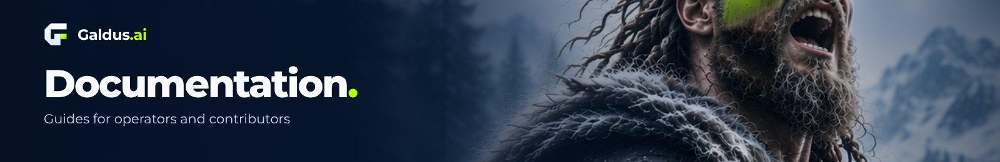

# Documentation

| Guide | For | What it covers |
|:--|:--|:--|
| [User guide](USER_GUIDE.md) | People using Galdus | Every module step by step, in the same order as the first-run tour |
| [Architecture](ARCHITECTURE.md) | Contributors, operators | Components, modules and the sign-in, chat, knowledge and automation flows |
| [Deployment](DEPLOYMENT.md) | Operators | Production build, GitHub Pages, Render, Supabase, Docker Compose, every environment variable, free-plan limits, smoke test |
| [Operations](OPERATIONS.md) | Operators | Deploy, rollback, secret rotation, backups and restore, monitoring, incidents |
| [API](API.md) | Developers | Conventions, examples, every endpoint; [OpenAPI document](api/openapi.json) |
| [Security overview](security/overview.md) | Everyone | Implemented controls and known limits |
| [Security review 2026-11-27](security/review-2026-11-27.md) | Everyone | Checks, findings, fixes and accepted residual risks |
| [Release checklist](RELEASE_CHECKLIST.md) | Owner | Verdict for production and what is left to do |
| [Roadmap](product/roadmap.md) | Everyone | What ships today and what comes next |
| [Architecture decisions](architecture/0001-modular-monolith.md) | Contributors | Why a modular monolith, and the domain map |
| [License compliance](license-compliance.md) | Maintainers | AGPL-3.0 checklist before each release |
| [Project handoff](CLAUDE_HANDOFF.md) | AI coding agents | Context to continue development |

Brand assets live in [`assets/`](assets): logo, animated logo, banner, social preview, page headers and the screenshots in [`assets/screens`](assets/screens). The social preview (`assets/social-preview.png`, 1280 by 640) is uploaded in the repository settings under **Social preview**.
