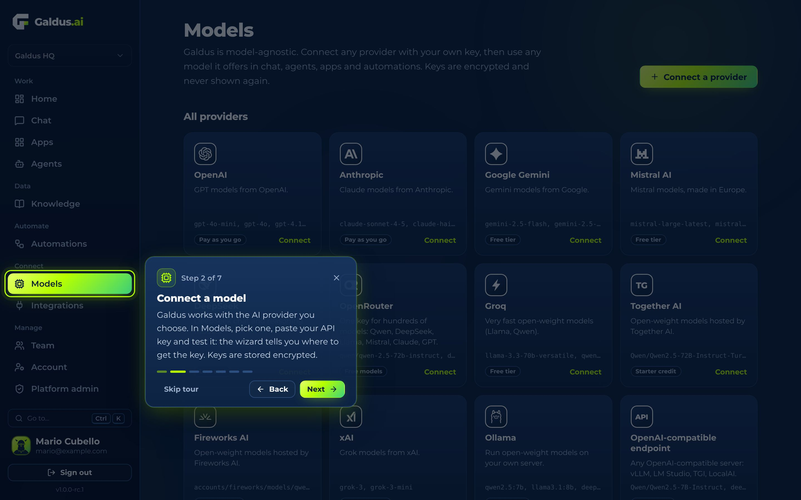

# User guide

Welcome to Galdus.ai. This guide follows the same path as the tour you see at your first sign-in: Home, connecting a model, chat, knowledge, agents, automations, and your account. You can replay the tour at any time from **Account, Help, Replay the tour**.

## Getting started

1. Open the console and choose **Create a workspace**: your name, a workspace name (your company or team), your email and a password of at least 12 characters. You can also continue with Google, GitHub or Microsoft when the server offers them.
2. If the server sends emails, confirm your address with the link you receive (valid 48 hours). Until then a banner reminds you and can send the link again.
3. The tour starts. Use **Next** and **Back**, or the arrow keys; **Skip tour** or `Esc` closes it. It is shown once per account, not once per browser.

Forgot your password? On the sign-in page choose **Forgot password?**: the link works once, for one hour, and signs out every other device.

## 1. Home

Home shows what is set up and what is missing, with a button for the next step, plus your recent activity. The sidebar (the menu button on a phone) takes you everywhere; `Ctrl K` (or `Cmd K`) opens a quick search of pages and actions.

## 2. Connect a model

Galdus works with the AI provider you choose; you bring your own key.

1. Open **Models** and pick a provider: OpenAI, Anthropic, Google Gemini, Mistral, DeepSeek, OpenRouter, Groq, Together AI, Fireworks AI, xAI, Ollama, or any OpenAI-compatible endpoint (vLLM, LM Studio, TGI).
2. The wizard explains where to create the key on the provider's site. Paste it, choose a model (or type any model name the provider offers) and select **Test and connect**: Galdus sends a tiny request and tells you what to fix if it fails.
3. Keys are stored encrypted and never shown again; only the last four characters are displayed.

Only workspace owners and admins connect models; members use them.

## 3. Chat

- Type and press `Enter` (`Shift Enter` for a new line); the answer streams in. **Stop** and **Regenerate** are next to it.
- **Persona**: general assistant, business analyst, writer, IT expert, software engineer or tutor.
- **Attachments**: drop or paste text files, PDFs and images (images need a model that supports them).
- **Knowledge**: ground a chat on a collection to get answers with numbered sources you can open.
- Chats are saved, searchable and can be pinned. Your personal instructions and answer style (Account, Personalize your chat) apply to every new message.

## 4. Knowledge

1. Open **Knowledge** and create a collection. Optionally pick an embedding model for semantic search; without one Galdus uses keyword search.
2. Add documents: upload PDF, text, Markdown, CSV, JSON or HTML files (up to 5 MB), import a public web page, or import from Google Drive, SharePoint and OneDrive once an admin connects them in **Integrations**.
3. **Search** shows the passages Galdus would use. Imported drive files re-sync daily.

## 5. Agents and apps

- An **agent** is a reusable assistant: instructions, a model, an optional knowledge collection and tools (date and time, calculator, web page fetch, knowledge search, and any MCP server tools an admin allowed). **Run** it with an input and review every step and tool call.
- **Apps** are ready-made tools: chat with documents, summarize, rewrite tone, draft an email, IT ticket triage, contract review, meeting notes to actions, translate. Fill in the form, pick a model, run.

## 6. Automations

1. Open **Automations, New automation**. The wizard asks for the task (an agent and what to ask it), the trigger and where to send the result.
2. Triggers: a schedule (for example every weekday at 8, at most every 15 minutes), a webhook that other tools call (n8n, Make, Zapier, your ticketing tool), or both. The webhook address is shown once: keep it secret.
3. Delivery: Slack, Microsoft Teams or any https webhook.
4. **Try it now** / **Run now** runs it immediately so you can check the result. After five failures in a row an automation pauses itself.

## 7. Account and security

- **Profile**: name and photo (PNG, JPEG or WebP; drag and zoom to frame it).
- **Personalize your chat**: what Galdus should know about you, and short, balanced or detailed answers.
- **Two-step verification**: scan the QR code with an authenticator app, confirm a code and save the ten recovery codes somewhere safe. From then on every sign-in asks for a code. Too many wrong codes lock the step for a few minutes.
- **Password**: change it (other devices are signed out) or set one if you signed up with Google, GitHub or Microsoft.
- **Sign out everywhere**: ends every session at once.
- **Download my data**: a JSON file with your profile, sign-ins, workspaces, chats, runs and usage.
- **Delete account**: confirm with your password (or your email if you have no password). Workspaces you are the only member of are deleted too; if you are the only owner of a shared workspace, make someone else owner in **Team** first.
- **Help**: replay the tour; the console and API versions are shown here too.

## Teams and workspaces

- **Team** lists members and roles. Owners change roles and workspace policies (name, monthly token limit, guardrails); owners and admins invite people. The invitation link works once, for that email address, for 7 days.
- If you belong to several workspaces, switch with the selector at the top of the sidebar.
- **Audit log** (owners and admins) records sensitive actions: members, invitations, model connections, knowledge, agents, automations, MCP servers, drives and settings.

## Good to know

- Sign-in is limited: after 5 wrong passwords in 15 minutes the account waits 15 minutes. Use **Forgot password?** if you are stuck.
- Your session lasts 30 minutes and ends when you close the tab.
- Do not paste secrets into chats: they are sent to the model provider you chose.
- Legal pages: [privacy](https://coobox-89.github.io/galdus.ai/privacy), [terms](https://coobox-89.github.io/galdus.ai/terms), [acceptable use](https://coobox-89.github.io/galdus.ai/acceptable-use).
