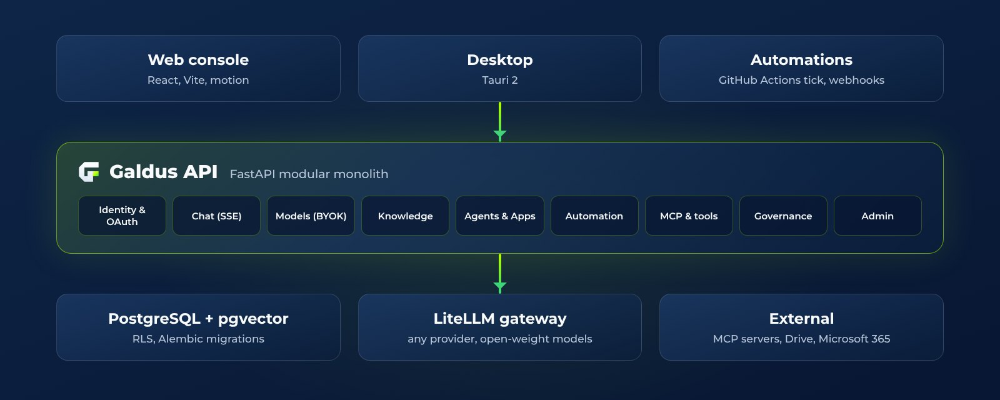

# ADR 0001: Modular monolith first

| | |
|:--|:--|
| Status | Accepted |
| Decision | Start with a modular monolith and explicit domain boundaries |
| Rationale | Local development and hosting stay simple while the product surface changes. A service is extracted only when scaling, isolation or team ownership gives a concrete reason. |

## Domain map

| Domain | API module | Web page |
|:--|:--|:--|
| Identity and accounts | `identity.py`, `accounts.py`, `oauth.py` | sign-in, `account.jsx` |
| Chat | `conversations.py`, `chat.py` | `chat.jsx` |
| Models | `providers.py`, `connections.py`, `crypto.py` | `models.jsx` |
| Knowledge | `knowledge.py`, `connectors.py` | `knowledge.jsx`, `drives.jsx` |
| Agents and apps | `agents.py` | `agents.jsx`, `apps.jsx` |
| Automation | `automation.py` | `automations.jsx` |
| Integrations | `tools.py` (MCP and built-in tools) | `integrations.jsx` |
| Governance | `governance.py`, `guardrails.py`, `ratelimit.py` | `team.jsx` |
| Platform admin | `admin.py` | `admin.jsx` |
